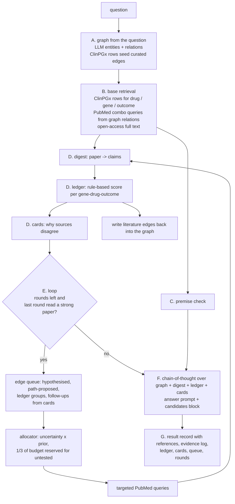

# Multi-Source Evidence Agent: current architecture (phase 15) and what changed

Status as of 2026-10-27. This describes the system as it runs today, in the order the code
runs it, and then the changes that produced it. Numbers and benchmark results are kept out;
they live in `results/benchmarks.md`.

## 0. In one paragraph

For one pharmacogenomics question ("which biomarkers predict cisplatin-induced ototoxicity?",
"which genes affect clopidogrel response?") the agent builds a small knowledge graph from the
question, seeds it with the curated ClinPGx (PharmGKB) rows for the question's drug, gene and
outcome, retrieves PubMed literature with queries composed from graph relations, reads each
paper paragraph by paragraph into structured claims, scores every gene–drug–outcome group
with fixed rules (no LLM in the scoring), explains disagreements between sources, and then
spends a search budget on the groups that are most uncertain or that typed paths over the
global ClinPGx graph propose as missing, repeating read → score → explain after each round.
The answer is written from the ledger and the disagreement cards, with a separate block of
literature-only candidate associations, and every claim keeps its paragraph-level reference.

## 1. What runs where

| part | choice |
|---|---|
| LLM | qwen2.5:14b (Q4_K_M) served by Ollama on the job's GPU, reached through `ChatOpenAI` at `LLM_BASE_URL=http://127.0.0.1:11434/v1`; no remote API |
| curated knowledge | ClinPGx bulk tables `clinicalVariants.tsv` and `relationships.tsv` (`dataset/ADR_DataSet/`), indexed once by `pgx_kb.PharmGKBSearcher` |
| literature | NCBI E-utilities (esearch/efetch), PMC full text, Europe PMC, Unpaywall; abstracts and full text cached per PMID; ~3 calls/s |
| vocabularies | MeSH (synonyms, tree parents) in `dataset/mesh_cache.json`; NCBI Gene symbols in `dataset/gene_cache.json`; both read-only offline |
| entry point | `AMG_RAG_System.answer_open_question()` in `AMG-with-KG.py`, driven by the resume-safe batch runner `run_genmedgpt.py` |
| configuration | environment variables read once in `__init__`; with none set, phase 13 runs unchanged (section 6) |

## 2. Per-question pipeline



### A. Graph from the question

`answer_open_question` resets all per-question state (graph, evidence log, digest cache,
edge queue, rounds), then `build_knowledge_graph(question, {})` runs the original AMG-RAG
chains: LLM entity extraction with relevance scores, bidirectional relation extraction between
entity pairs, entity summaries. During this build every retrieval goes through one seam,
`_evidence_search_detailed`, which with `AMG_KB_SOURCE=pharmgkb+…` consults ClinPGx first:
rows for the question's drug (exact name, or its MeSH drug class with `match=class`), gene and
phenotype are logged as `ClinPGx:GENE/variant:Llevel` and become **curated edges** whose weight
is the evidence level. LLM-proposed relations stay **hypothesised edges**; they are search
leads only and never compose into paths or claims.

### B. Base retrieval (phase 9/13 shape)

- ClinPGx rows for the question terms (above), with the PMIDs the `relationships` table cites.
- PubMed **combo queries**: terms that the graph relates are searched together as one
  conjunctive query (`cisplatin AND hearing loss AND polymorphism`), `AMG_COMBO_MAX_QUERIES`
  of them, `AMG_OPEN_PER_PHRASE` results each, logged with their shape in `search_shape`.
- At the reasoning stage each abstract is upgraded to open-access full text when one exists
  (PMC JATS → Europe PMC → Unpaywall → PMC PDF), capped at `AMG_FULLTEXT_MAX_CHARS`.

### C. Premise check

`_pgx_premise_note`: if the question asserts a gene–drug link that the tables hold no
association for, a corrective note is prepended to both the chain-of-thought and the answer
prompt. It tests asserted pairs only; it does not test whether a drug exists (section 8).

### D. Evidence assessment (`_assess_evidence`)

1. **Digest** (`_digest_one_paper`, LLM): each retrieved paper is read in bounded batches of
   paragraphs (`AMG_DIGEST_BATCH_CHARS`, `AMG_DIGEST_MAX_BATCHES`, at most
   `AMG_DIGEST_MAX_PAPERS` new papers per round) and reduced to one record: `genes_supported`,
   `genes_refuted`, `drugs_studied`, `evidence_kind` (germline variant / somatic / expression
   / protein biomarker), `study_type` (majority vote over batches, overridden by PubMed's own
   publication-type tag when it names a design), `population`, `cancer_type`, `endpoint`,
   `dose_context`, `direction`, and the paragraph references (`PMID/PMC#pNN`) behind each
   finding. Retracted papers are skipped. Digests are cached per question so later rounds only
   read new papers.
2. **Ledger** (`evidence_ledger.py`, no LLM): curated rows and digest findings become `Claim`
   records and are grouped by gene + drug + **outcome** (outcome normalised through MeSH
   families). A claim whose `drugs_studied` matches neither the question's drug nor its class
   is excluded and reported in `off_drug_claims`. Each group gets a score from the formula in
   section 5, a high / moderate / low / very low label, and typed contradiction flags.
   Literature genes are checked against NCBI Gene (`gene_symbols.py`): unverified names
   (families like "CBR", aliases like "MATE1") stay in the ledger but cannot be candidates.
3. **Cards** (`contradiction_layer.py`, no LLM): claims are tiered curated / clinical /
   mechanistic / narrative; only comparable tiers can conflict, so a mechanistic null result
   becomes a note instead of a contradiction. Each group receives one status, `CONSISTENT`,
   `CONFLICTING`, `CONTEXT-DEPENDENT` (with the separating axis: population, cancer type,
   endpoint, dose), `CURATED-LITERATURE CONFLICT` or `INSUFFICIENT`, and a one-line
   conclusion.

### E. The loop (`_run_search_rounds`, phase 15)

Runs `max(AMG_SEARCH_ROUNDS, 1 if AMG_PATH_DISCOVERY)` rounds:

1. `_populate_queue` adds every candidate (gene, drug, outcome) as an `Edge` with a status,
   a provenance and a prior: LLM-hypothesised genes that are in the ClinPGx vocabulary; in
   round 1 the **typed-path proposals** from `graph_paths.py` (section 4); every ledger group
   with its current status; and **follow-up queries** derived from unresolved cards.
2. `EdgeQueue.select(budget)` ranks edges by uncertainty × prior (uncertainty is highest for a
   score near 0.5, few sources, or an `INSUFFICIENT` card) and reserves a third of the budget
   for untested edges so discovery is never starved by curated-but-insufficient pairs.
3. Each chosen edge is searched (`gene AND drug AND outcome`; a second attempt drops the
   outcome and adds association language; no query string is issued twice in a question),
   full text is fetched for the top two hits, and the round is logged in `search_rounds`.
4. Digest → ledger → cards run again on the new papers; the queue takes the new statuses.
5. **Write-back**: literature-backed groups with score ≥ 0.25 become graph edges carrying
   their score and references, or attach their references to the existing curated edge.
6. **Stop rule**: the loop ends early when a round reads no cohort-or-better paper
   (meta-analysis, systematic review, GWAS, cohort, trial), the guard against evidence
   dilution.

### F. Reasoning and answer

The chain-of-thought chain sees the graph context (paths and connections), the digest block,
the ledger block (top 12 groups plus a **candidates** block of literature-only associations
outside that cut, each with its proposing path and references) and the cards block. The
answer chain is chosen by `AMG_ANSWER_STYLE` (`adr`: drug-safety assessment, used for all
benchmarks; `pgx`: terse factual; `doctor`: GenMedGPT reply). It reports the candidate
associations in their own paragraph and returns `candidate_genes` beside `risk_genes`. If the
model's JSON cannot be parsed, `_salvage_open_answer` keeps the free text; if every call
failed, the sentinel fallback answer is written and the runner retries the item next time.

### G. Result record (one JSON line per question)

`generated_answer`, `risk_genes`, `candidate_genes`, `references` (deduplicated citations),
`evidence_log` (every retrieval with stage and ref), `search_shape`, `paper_digests`,
`gene_ledger`, `contradiction_cards`, `path_candidates`, `edge_queue` (final statuses),
`search_rounds`, `off_drug_claims`, `graph_stats`.

## 3. Modules

| file | role | LLM? |
|---|---|---|
| `AMG-with-KG.py` | the system: chains, graph, retrieval seam, digest, loop, answer | yes |
| `pgx_kb.py` | ClinPGx tables: lookup by drug / gene / phenotype, exact and MeSH-class match, premise membership test, vocabularies | no |
| `graph_paths.py` | global ClinPGx graph; typed 2-hop proposals A (gene–outcome), C (gene–drug class), B (gene–gene, Adamic–Adar hub penalty), ranked by citation count | no |
| `edge_queue.py` | `Edge` records with status / provenance / prior; the allocator; query-term construction; statuses from ledger and cards | no |
| `evidence_ledger.py` | claims, grouping by outcome, score formula, labels, contradiction flags, prompt block | no |
| `contradiction_layer.py` | tiers, five statuses, axis explanation, conclusions, follow-up query generation, prompt block | no |
| `mesh_terms.py` | MeSH synonyms, tree parents, outcome families, drug classes (cached) | no |
| `gene_symbols.py` | NCBI Gene symbol verification for literature genes (cached) | no |
| `run_genmedgpt.py` | batch runner: resume by id, failed items never written, persists every record field | – |
| `tests/test_phase15_*.py` | offline tests: modules, ledger rules, and the full loop with fake PubMed and digest | – |

## 4. The edge queue

| edge source | provenance | prior |
|---|---|---|
| ClinPGx rows for the question's drug | `curated` | from the evidence level |
| LLM relation extraction (gene in ClinPGx vocabulary) | `hypothesised` | 0.30 |
| path A: gene linked to the question's outcome (MeSH synonyms) | `path:A:outcome` | 0.50 |
| path C: gene curated for the drug's MeSH class (e.g. Platinum compounds) | `path:C:class` | 0.55 |
| path B: gene–gene neighbour of a curated gene, hub-penalised | `path:B:gene` | 0.35 |
| claims read from papers in an earlier round | `literature` | ledger score |
| follow-up from a card | `followup:<status>:<axis>` | 0.60 |

Pattern C never proposes a pair the tables mark "not associated"; those reach the ledger as
curated negatives through class matching. When the question names a class (anthracyclines),
the class node is treated as the drug's own node so curated class genes are not "new".

## 5. Rules

**Ledger score** per gene–drug–outcome group:

```
score = clip( base × (1 + 0.18·ln(1 + W_sup)) − 0.30·ln(1 + W_ref), 0, 1 )   × 0.9 if the curated status is "ambiguous"
```

- `base`: curated level 1A 0.98 … 4 0.40; associated without level 0.55; absent from ClinPGx
  0.25, raised to 0.45 once two independent cohort-or-better sources support it (so a
  literature-only pair tops out near 0.64 and is never "high"); curated "not associated" 0.15.
- `W_sup`, `W_ref`: sums over distinct sources of study weight (curated and meta-analysis
  1.0, systematic review 0.95, GWAS 0.9, cohort and trial 0.85, case report 0.45, review 0.4,
  animal 0.3, in vitro 0.2, unknown 0.4) × evidence-kind factor (germline 1.0; somatic,
  expression, protein biomarker 0.5).
- These constants are heuristic choices; the scores are not calibrated probabilities.

**Card statuses**: `CONSISTENT` (comparable sources agree), `CONFLICTING` (clinical sources
disagree, no axis found), `CONTEXT-DEPENDENT` (disagreement explained by population, cancer
type, endpoint or dose), `CURATED-LITERATURE CONFLICT`, `INSUFFICIENT` (fewer than two
comparable clinical sources).

**Follow-up queries**: `INSUFFICIENT` → gene AND drug AND outcome restricted to
meta-analysis / systematic review / cohort; `CONTEXT-DEPENDENT` → the same plus the refuting
side's axis value; `CONFLICTING` without an axis → plus "replication".

## 6. Configurations

All differences between configurations are environment variables; the code is one file.

| variable | phase 13 | phase 15 (ADR job) | phase 15 lite (benchmarks) |
|---|---|---|---|
| `AMG_KB_SOURCE` | `pharmgkb+pubmed_combo` | same | same |
| `AMG_COMBO_MAX_QUERIES` / `AMG_OPEN_PER_PHRASE` | 4 / 2 | 4 / 2 | 4 / 2 |
| `AMG_PAPER_DIGEST`, `AMG_EVIDENCE_LEDGER`, `AMG_CONTRADICTION_LAYER` | 1, 1, 1 | 1, 1, 1 | 1, 1, 1 |
| `AMG_PUBMED_FULLTEXT` / `AMG_FULLTEXT_MAX_CHARS` | 1 / 3000 | 1 / 3000 | 1 / 3000 |
| `AMG_DIGEST_MAX_PAPERS` / `_BATCH_CHARS` / `_MAX_BATCHES` | 6 / 2400 / 6 | 6 / 2400 / 6 | 4 / 2400 / 6 |
| `AMG_PATH_DISCOVERY` / `AMG_PATH_MAX_CANDIDATES` | 0 | 1 / 10 | 1 / 10 |
| `AMG_SEARCH_ROUNDS` / `AMG_QUERY_BUDGET` | 0 | 2 / 6 | 1 / 4 |
| `AMG_FOLLOWUP_SEARCH` | 0 | 1 | 1 |
| `AMG_ANSWER_STYLE` | `adr` | `adr` | `adr` |

Ablation rungs used on PGxQA (`run_bench_alliance.bash`, stage `pgxqa_ablate`): **LLM-only**
(no retrieval; the model's knowledge through the graph), **original AMG-RAG** (PubMed and
Wikipedia, `AMG_USE_EXTERNAL=1`), **tables only** (`AMG_KB_SOURCE=pharmgkb`, phase-3 setup),
**plain RAG** (phase-13 retrieval with raw article text in the prompt; digest, ledger and
cards off), **phase 13 at the same search budget as phase 15 lite**, **phase 15 lite**.

Job scripts: `run_adr_phase15_alliance.bash` (ADR development questions),
`run_bench_alliance.bash` (benchmarks, one stage per job), `run_extbase_alliance.bash`
(external systems), `run_bench_score_alliance.bash` (CPU scoring with BERTScore).

## 7. What changed, in order

**Phase 13 → phase 15 (2026-10-22/23).** Plan in `docs/PLAN.md`.

1. Prerequisite fixes (`9037619`, `5ac921b`): ledger groups by outcome; `drugs_studied`
   extracted and off-drug claims excluded; MeSH synonyms and drug classes replace the
   hand-written tables where MeSH has them; `evidence_kind` extracted and non-germline
   evidence halved; study type by majority vote with PubMed publication-type override;
   retracted papers dropped; the literature cap lifted so literature-only pairs can reach
   0.64; `uncurated_literature_claim` no longer counts as a dispute.
2. New modules (`6a6bdcd`): `graph_paths.py` (typed-path proposals over the global tables)
   and `edge_queue.py` (statuses, provenance, priors, allocator with reserve).
3. Wiring (`b35c3a1`): `_populate_queue`, `_run_search_rounds`, write-back, stop rule,
   follow-up queries from cards, the candidates block in the prompt; tests in `tests/`
   (`3666bf4`); NCBI rate limiting (`ff039b6`).
4. After the first GPU run (`663acde`): the runner now persists the loop's fields; the answer
   prompt reports candidates in their own paragraph and returns `candidate_genes`;
   `gene_symbols.py` verifies literature gene names; path proposals ranked by citation count;
   class nodes treated as the drug's node.

**Evaluation infrastructure since (2026-10-23 → 27).** No change to the system itself.

- Benchmarks (`cd589c5` and following): PGxQA 76-item subset with list, refusal and consult
  scoring; PGxCorpus extraction scoring of the digest chain; masked-association recovery
  (`make_masked_recovery.py` hides ten curated pairs and their class rows from both tables).
- External systems under `extbase/` (`69fe238` and following): MedRAG, i-MedRAG, LightRAG,
  PaperQA2 (agent and fixed pipeline) on the same model and a shared PubMed abstract corpus;
  the PGxQA paper's published GPT-4o / GPT-4-turbo / Llama-3-70B / GPT-3.5 / Gemini answers
  rescored on our items (`convert_pgxqa_reference.py`).
- Fairness check (`9571e93`): `extbase/build_clinpgx_docs.py` renders the ClinPGx tables as
  documents so PaperQA2 can be run with the same inputs as phase 15.
- Ablation ladder stage (`06019a1`) and bootstrap intervals with paired tests in
  `eval_pgxqa.py` (`062606e`).

## 8. Not in the architecture yet

- **Drug-existence check** before answering (ClinPGx vocabulary, MeSH, PubMed hit count):
  the premise check only tests asserted gene–drug pairs, so an invented drug name that
  resembles a real one is answered.
- **"No guideline-level evidence" sentence** when the ledger holds only level-3/4 or
  ambiguous rows, so a real entity without a CPIC guideline is reported as such instead of
  as a plain association.
- `CONSISTENT` almost never fires because most ClinPGx pairs in this domain are marked
  ambiguous; context fields (population, cancer type, dose) are extracted unevenly by the
  14B model, which leaves some conflicts unexplained.
- Budgets (rounds, queries, papers per round) were set by hand; the benchmarks ran the
  lite budget for wall-time reasons.
